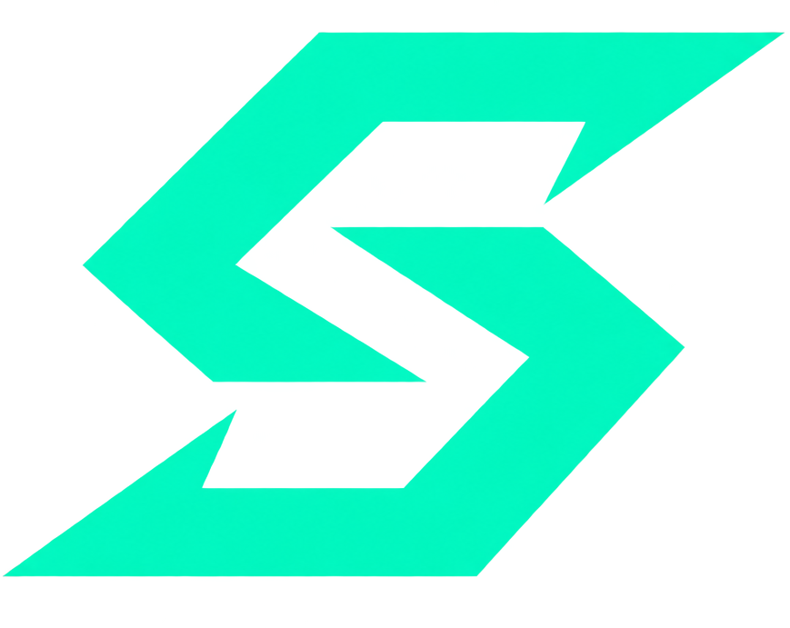

  

Runas, feitiços e build de elo Mestre+ no cliente do LoL antes da partida começar.

<h3><a href="https://github.com/brocco054/shazam-releases/releases/latest">Baixar para Windows</a></h3>

 

## O que ele faz

<table>
<tr>
<td width="50%" valign="top">&nbsp;<b>Leitura do draft</b> Reconhece seu campeão e deduz a rota de cada inimigo pela taxa de pick.</td>
<td width="50%" valign="top">&nbsp;<b>Runas Mestre+</b> Três páginas: a geral, a mais usada e a de maior winrate contra o seu oponente.</td>
</tr>
<tr>
<td valign="top">&nbsp;<b>Importação no cliente</b> Runas e feitiços entram sozinhos no LoL. Você só confirma o pick.</td>
<td valign="top">&nbsp;<b>Build</b> Aparece na hora e é atualizada com os dados do LoLalytics.</td>
</tr>
<tr>
<td valign="top">&nbsp;<b>Matchup</b> Ordem das skills e dicas da Riot para jogar contra cada campeão.</td>
<td valign="top">&nbsp;<b>Skills em vídeo</b> Cada habilidade com vídeo curto, descrição e recarga.</td>
</tr>
<tr>
<td valign="top">&nbsp;<b>Overlay na partida</b> HUD discreto por cima do jogo. Os cliques passam direto.</td>
<td valign="top">&nbsp;<b>Narrador</b> Avisos em voz, com volume nas configurações.</td>
</tr>
<tr>
<td valign="top" colspan="2">&nbsp;<b>Atualiza sozinho</b> Quando sai versão nova, o app avisa e instala com um clique.</td>
</tr>
</table>

## Instalação

1. Baixe o `Shazam-Setup` na [página de versões](https://github.com/brocco054/shazam-releases/releases/latest). Se preferir não instalar, use o `Shazam-Portatil`.
2. Abra o instalador e siga os passos.
3. Deixe o Shazam aberto e entre numa fila no LoL. No draft ele já começa a trabalhar.

> [!NOTE]
> Na primeira vez o Windows pode mostrar o aviso do SmartScreen. Clique em **Mais informações** e depois em **Executar assim mesmo**.

##  Atalhos

| Teclas | Ação |
|---|---|
| <kbd>Ctrl</kbd> <kbd>Shift</kbd> <kbd>O</kbd> | Mover o overlay |
| <kbd>Ctrl</kbd> <kbd>Shift</kbd> <kbd>H</kbd> | Mostrar ou esconder o overlay |

## Perguntas

**Pode dar ban?**
O Shazam usa só a API do próprio cliente (LCU) para mexer em runas e feitiços, como Porofessor e Blitz. Ele não lê nem altera a memória do jogo.

**Funciona sem internet?**
Não. Os dados vêm online. Sem conexão o app fica bloqueado e tenta de novo a cada 20 segundos.

 

Shazam não é endossado pela Riot Games e não reflete as opiniões da Riot Games ou de qualquer pessoa envolvida na produção ou gestão de League of Legends. League of Legends e Riot Games são marcas registradas da Riot Games, Inc.
